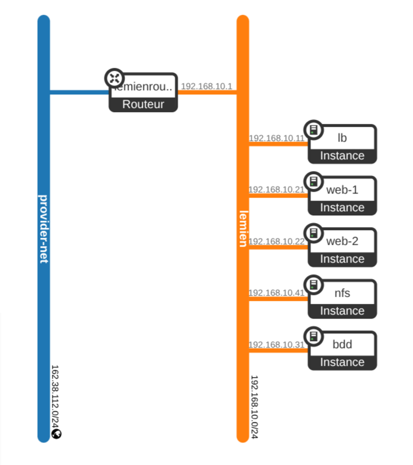

# TP2 — WordPress load-balanced on OpenStack

Terraform configuration for a five-instance WordPress stack:

```
Internet -> Floating IP -> HAProxy -> web-1 / web-2 -> bdd (MariaDB)
                                                    -> nfs (wp-content/uploads)
```



The Horizon view of the applied stack: `provider-net` on the left, the tenant
network `lemien` on the right, joined by the router `lemienroux` which holds
the subnet gateway at `192.168.10.1`.

Only the load balancer holds a floating IP. The other four instances sit on
the tenant network and reach the internet outbound through the
router. SSH to them goes through the balancer, which doubles as a bastion.

## Prerequisites

These must already exist in the project; the configuration looks them up:

| Resource | Default name | Variable |
| --- | --- | --- |
| External network | `provider-net` | `external_network_name` |
| Image | `debian-12` | `image_name` |
| Flavor | `m1.small` | `flavor_name` |
| Keypair | `mapaire` | `keypair_name` |

Everything else is created by Terraform, including the tenant network, its
subnet and the router. Only the external network and the keypair are looked
up rather than managed.

## Before the first apply

Check these on the remote cloud, in this order:

1. **Quota.** Five `m1.small` instances need 5 vCPU, 10 GB RAM and 100 GB of
   disk. Run `openstack limits show --absolute`.
2. **External network name.** `openstack network list --external`. The value
   lives in `10-infra/terraform.tfvars`, which is untracked; copy it from
   `terraform.tfvars.example`.
3. **Floating IP.** The tenant is limited to a small number. Release any
   unattached one with `openstack floating ip list --status DOWN` before
   applying.

## Layout

The stack is split into two root modules with separate states, so the
instances can be rebuilt without releasing the single floating IP the tenant
is allowed.

| Layer | Holds | Lifecycle |
| --- | --- | --- |
| `10-infra/` | network, subnet, router, security groups, floating IP | rarely changes |
| `20-platform/` | ports, instances, cloud-init, generated inventory | rebuilt freely |

`20-platform` reads the layer below through `terraform_remote_state`, pointed
at `../10-infra/terraform.tfstate`. The dependency is one-way.

## Usage

Apply bottom-up:

```bash
source ~/jvilardell-openrc.sh

cd 10-infra && terraform init && terraform apply
cd ../20-platform && terraform init && terraform apply
```

Then follow the outputs:

```bash
terraform output site_url
terraform output -raw ssh_config >> ~/.ssh/config
```

Destroy top-down, in the reverse order. Destroying `10-infra` while
`20-platform` still holds instances leaves the lower layer unable to delete
its network, and releases the floating IP.

```bash
cd 20-platform && terraform destroy
cd ../10-infra && terraform destroy
```

WordPress serves its installation wizard on first visit. The database, the
user and the shared upload mount are already in place.

## Addresses

Addresses are pinned in `variables.tf` rather than left to DHCP, because the
HAProxy backend list, the MariaDB grant and the NFS export are all rendered
from the same values at plan time. Changing the subnet means changing those
variables together.

## Known limitations

- **Storage is ephemeral.** The database and the NFS export live on the
  instances' ephemeral disks. `terraform destroy`, or an instance rebuild,
  loses the content. Moving `bdd` and `nfs` to Cinder volumes is the next
  step if the data has to survive.
- **The balancer is a single point of failure.** One floating IP means no
  second balancer and no VRRP.
- **HTTP only.** No TLS termination on HAProxy yet; `WP_HOME` is pinned to
  `http://<floating-ip>`.
- **The MariaDB grant pattern assumes a /24** tenant subnet.
